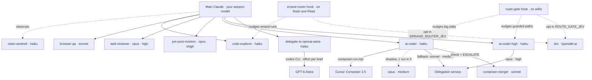
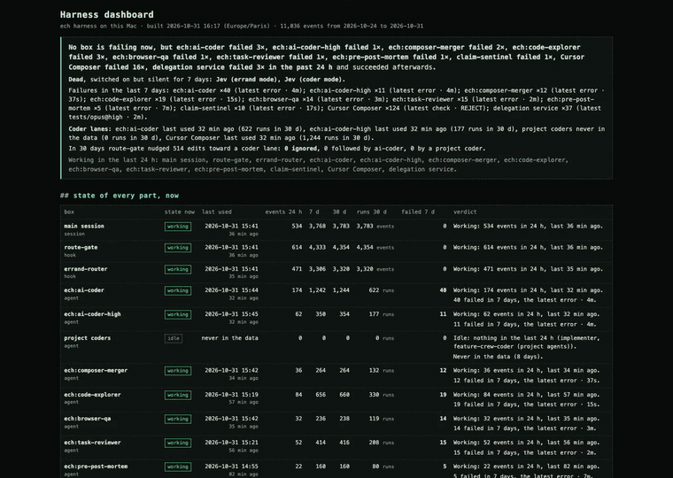

# efficient-claude-harness


A Claude Code plugin, `ech`: agents, skills and hooks that keep your conversation small by sending each piece of work to the cheapest lane that can do it — and one dashboard that shows whether those lanes are still alive.

## Install

```
/plugin marketplace add gmorel/efficient-claude-harness
/plugin install ech@efficient-claude-harness
```

Per project, for a whole team:

```bash
claude plugin marketplace add gmorel/efficient-claude-harness --scope project
claude plugin install ech@efficient-claude-harness --scope project
```

The plugin has no `version` field on purpose: each commit is a new version, so you track the repository rather than release numbers.

## One plugin per initiative

`plugins/ech` stays as the whole harness. The same pieces are also split into small plugins you can install alone:

| Plugin | What it is |
|---|---|
| `ech-coder` | ai-coder, ai-coder-high, composer-merger, the route-gate hook, the delegation skill and command |
| `ech-pre-postmortem` | the pre-post-mortem agent and command |
| `ech-claim-check` | a Haiku turn-end check for unverified claims, with an optional observer agent |
| `ech-errand` | the errand-router hook (warn, or enforce per project) and the Haiku code-explorer |
| `ech-codex-review` | read-only Codex review: sol-reviewer, OpenAI reviewers, Astra, a Codex-first PR review skill |
| `ech-mailbox` | holds peer-session messages until you ask; off by default |
| `ech-context` | session-size hint and compact guard |
| `ech-eli5` | the ELI5 one-card output style and its Stop hook |

Each folder has its own README with the install line, which local copy to switch off while you test it, and how to roll back.
Install one with `/plugin install ech-coder@efficient-claude-harness`.
Avoid enabling `ech` together with a split plugin that carries the same hook: both would register it.

## Directory map

| Directory | What is in it |
|---|---|
| [`.claude-plugin/`](.claude-plugin/README.md) | The marketplace manifest: the list of plugins. |
| [`.github/`](.github/README.md) | The CI workflow that validates and tests every plugin. |
| [`ai-coder/`](ai-coder/README.md) | The animated diagram above and the skill that rebuilds it. Not a plugin. |
| [`docs/`](docs/README.md) | Images and the long reference. |
| [`lib/`](lib/README.md) | Files shared by several plugins, kept in sync by a script. |
| [`plugins/`](plugins/README.md) | The plugins: `ech` and the eight small ones. |
| [`scripts/`](scripts/README.md) | Repository tooling: the lib sync and the per-plugin test runner. |
| [`tests/`](tests/README.md) | Repository-level tests. |

## How work flows



Labels read `agent · model · effort`; the `haiku` lanes are thin wrappers, and the model on the arrow does the real work.
Dotted arrows from the two hooks are notes added to Claude's context, never an automatic call. The Jev arrows exist only when you opt in.

## What is inside

| Component | Kind | What it does |
| --- | --- | --- |
| `ech:ai-coder` | agent | Default coding lane: briefs Cursor Composer 2.5, runs it in place, checks the result, commits nothing. Falls back to the delegation service. |
| `ech:ai-coder-high` | agent | Guarded lane — migrations, auth, payments, secrets, CI, git hooks. Needs a written plan; runs at `opus`/`high`. |
| `ech:composer-merger` | agent | Only on `ESCALATE` (tests pass but the diff touched tests): looks for weakened assertions and re-runs them. |
| `ech:code-explorer` | agent | Returns `file:line` hits and nothing else. |
| `ech:browser-qa` | agent | Drives a real browser, screenshots, reports PASS/FAIL per check. Local hosts only. |
| `ech:task-reviewer` | agent | Read-only: judges a finished task against its brief. |
| `ech:pre-post-mortem` | agent + command | Imagines a risky change already failed and works backwards. Expensive; risky changes only. |
| `ech:claim-sentinel` | observer | Flags success claims made without a ground-truth check. |
| `ech:delegate-to-openai-astra` | agent + skill | Forwards one task to GPT-6-Astra and returns the answer verbatim. Triggers only when you name Astra. |
| `ech:delegate-heavy-reasoning` | skill | How to send a job to the delegation service and apply the patch safely. |
| `/ech:delegate-to-external-ai` | command | The before-and-after checklist for a delegation-service job. |
| `route-gate` | hook, on edits | Catches a Composer-sized change being hand-written and suggests a lane. Warn-only by default. |
| `errand-router` | hook, on Bash and Read | Catches three or more read-only errands in a row and suggests `ech:code-explorer`. Warn-only by default. |
| `harness-dashboard` | scripts | The page in the recording above. |

The plugin has no npm dependencies of its own: Node built-ins only.

## The dashboard



The recording is a replay of synthetic ledgers. The interface is the real one; the project names in it are invented.

```bash
cd plugins/ech/scripts/harness-dashboard
node backfill.mjs   # transcripts → <data>/dashboard-cache/, metadata only
node build.mjs      # every ledger → <data>/harness-dashboard.html
node serve.mjs      # http://127.0.0.1:4783/ with a LIVE toggle
```

Your conversation is the centre of the onion: hooks in the first ring, the lanes they feed in the second, the engines behind them in the third, the observer above everything.
Each delegation rides out as a packet; the `layout` button switches to a top-down tree with the full text of every card.

The page reads complete with JavaScript off, and `build.mjs` fails if the JS-off and JS-on readings disagree.
Only enum fields, numbers and basenames ever reach it — no prompt text, no command text, no file contents, no error messages.
Flags and the optional per-agent run hook are in [its own README](plugins/ech/scripts/harness-dashboard/README.md).

## Choosing which engines run

A lane takes the **first enabled engine in its order**. Switching Composer off moves ordinary coding to the delegation service, not back into your own context — which is the whole point of the lanes. When every engine in a lane is off, the lane refuses and says so.

Copy `plugins/ech/config.example.json` to `~/.config/claude-harness/config.json`. Every field is optional.

```json
{
  "engines": {
    "composer":   { "enabled": true,  "model": "composer-2.5" },
    "delegation": { "enabled": true,  "model": "sonnet", "effort": "medium" },
    "codex":      { "enabled": false, "model": "codex@medium" },
    "astra":      { "enabled": false }
  },
  "lanes": {
    "coder":   { "order": ["composer", "delegation", "codex"] },
    "guarded": { "order": ["delegation", "composer"], "model": "opus", "effort": "high" }
  }
}
```

`node plugins/ech/scripts/lib/harness-config.mjs show` prints what is in force.
Environment variables override the file for CI or a single run: `HARNESS_ENGINE_CODEX=1`, `HARNESS_MODEL_DELEGATION=haiku@low`, `HARNESS_CONFIG=/path/to.json`.

The switch is real, not advisory: the agents call `harness-config.mjs pick <lane>` and run what it names, and the runners call the same module and **exit 3** when asked for an engine that is off. A malformed config is an error, never a silent return to defaults you did not choose.

## Prerequisites, per lane

Install only what the lanes you use need.

| Lane | Needs |
| --- | --- |
| Everything | Node 18 or later on `PATH`. |
| `ai-coder` (Composer) | `cursor-agent` on `PATH`, logged in to a Cursor account with Composer 2.5. Check with `node <plugin>/scripts/composer-run.mjs doctor`. |
| any lane on `opus@<effort>` | The `claude` CLI on `PATH`, logged in. |
| any lane on `codex@<effort>` | The OpenAI `codex` plugin installed, and a Codex login. |
| Delegation service | Your own deployment and key in `~/.config/claude-delegate/config.json` ([how](docs/reference.md#delegation-service-configuration)). |
| `delegate-to-openai-astra` | The `codex` CLI, logged in to an account with GPT-6-Astra. |
| `browser-qa` | npm reachable once (`npx -y @playwright/cli@0.1.22`) and a browser. |
| `claim-sentinel` | `CLAUDE_CODE_EXPERIMENTAL_OBSERVER_AGENTS=1`, plus [the attach step](docs/reference.md#attaching-claim-sentinel). |
| `harness-dashboard` | Nothing beyond Node. It only reads what is already on disk. |

## Switches

Both hooks only add a note to Claude's context. Neither blocks anything unless you opt in.

| Hook | Off | Warn (default) | Block |
| --- | --- | --- | --- |
| `route-gate` | `ROUTE_GATE=off` | `ROUTE_GATE=warn` | `ROUTE_GATE=deny`, or `{"mode":"deny"}` in `<data>/route-gate.json` |
| `errand-router` | `ERRAND_ROUTER=off`, or a `<data>/errand-router.off` file | `ERRAND_ROUTER=warn` | `ERRAND_ROUTER=block`, from the fifth errand in a row |

To turn both off without uninstalling, disable the plugin with `/plugin`.
Thresholds, silence rules, the control group and the opt-in Jev classifier are in [docs/reference.md](docs/reference.md).

## Where runtime data goes

Ledgers, shadow-run patch pairs, Astra job state and the dashboard's page and cache go to `~/.claude/plugins/data/ech-efficient-claude-harness/`, which Claude Code deletes on uninstall unless you pass `--keep-data`.
Set `HARNESS_DATA_DIR` to keep the history somewhere durable, or override one file at a time with `COMPOSER_LANE_LOG`, `DELEGATE_LEDGER`, `ROUTING_LEDGER`, `ERRAND_ROUTER_LEDGER`, `AGENT_RUNS_LEDGER` or `HARNESS_DASHBOARD_OUT`.
Run a script by hand, with neither variable set, and it falls back to `~/.claude/harness-data/`.

## Tests

```bash
env -u ERRAND_ROUTER_CONFIG HOME="$(mktemp -d)" node tests/plugin/run.mjs   # must exit 0; needs only node and git
```

Each split plugin has its own tests: `node scripts/run-plugin-tests.mjs plugins/<name>` and `claude plugin validate plugins/<name>`.
`node scripts/sync-lib.mjs --check` fails when a shared lib copy has drifted; run it without `--check` to copy `lib/shared/` out again.
A GitHub Action (`.github/workflows/plugins.yml`) is meant to run all of this for every plugin.

`node tests/parity/run.mjs` is the owner-only check against the original hooks; see [docs/reference.md](docs/reference.md#parity-check-against-the-original-hooks).
Agents working on this repository follow [AGENTS.md](AGENTS.md).

## Security notes

The coding scripts strip credential-shaped environment variables before spawning an engine, and `remote-run.mjs` refuses to send `.env` files, keys, and files containing secret-shaped strings.
`delegate.mjs` sends the files you name to the delegation service you configured, and nowhere else.
`browser-qa` is restricted by its instructions to local development hosts and the project's own fixtures.

## License

MIT. See [LICENSE](LICENSE).
