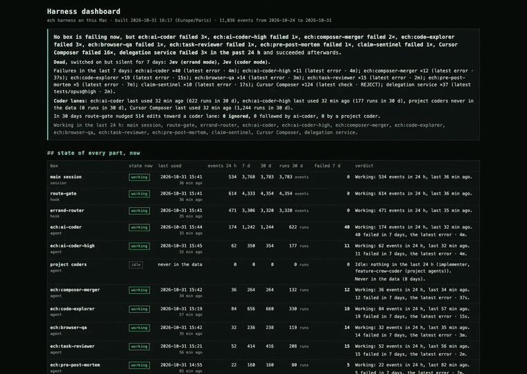
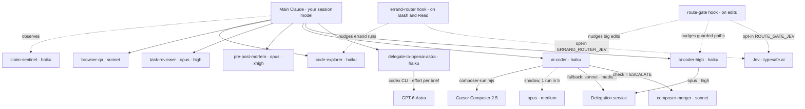

# efficient-claude-harness



A Claude Code plugin, `ech`: agents, skills and hooks that keep your conversation small by sending each piece of work to the cheapest lane that can do it — and one dashboard that shows whether those lanes are still alive.

The recording replays a week of synthetic ledgers, generated by [`docs/demo-ledgers.mjs`](docs/demo-ledgers.mjs) so you can rebuild it. The interface is the real one; the projects in it are invented.

## Install

```
/plugin marketplace add gmorel/efficient-claude-harness
/plugin install ech@efficient-claude-harness
```

Per project, for a whole team:

```bash
claude plugin marketplace add gmorel/efficient-claude-harness --scope project
claude plugin install ech@efficient-claude-harness --scope project
```

The plugin has no `version` field on purpose: each commit is a new version, so you track the repository rather than release numbers.

## How work flows



Labels read `agent · model · effort`; the `haiku` lanes are thin wrappers, and the model on the arrow does the real work.
Dotted arrows from the two hooks are notes added to Claude's context, never an automatic call. The Jev arrows exist only when you opt in.

## What is inside

| Component | Kind | What it does |
| --- | --- | --- |
| `ech:ai-coder` | agent | Default coding lane: briefs Cursor Composer 2.5, runs it in place, checks the result, commits nothing. Falls back to the delegation service. |
| `ech:ai-coder-high` | agent | Guarded lane — migrations, auth, payments, secrets, CI, git hooks. Needs a written plan; runs at `opus`/`high`. |
| `ech:composer-merger` | agent | Only on `ESCALATE` (tests pass but the diff touched tests): looks for weakened assertions and re-runs them. |
| `ech:code-explorer` | agent | Returns `file:line` hits and nothing else. |
| `ech:browser-qa` | agent | Drives a real browser, screenshots, reports PASS/FAIL per check. Local hosts only. |
| `ech:task-reviewer` | agent | Read-only: judges a finished task against its brief. |
| `ech:pre-post-mortem` | agent + command | Imagines a risky change already failed and works backwards. Expensive; risky changes only. |
| `ech:claim-sentinel` | observer | Flags success claims made without a ground-truth check. |
| `ech:delegate-to-openai-astra` | agent + skill | Forwards one task to GPT-6-Astra and returns the answer verbatim. Triggers only when you name Astra. |
| `ech:delegate-heavy-reasoning` | skill | How to send a job to the delegation service and apply the patch safely. |
| `/ech:delegate-to-external-ai` | command | The before-and-after checklist for a delegation-service job. |
| `route-gate` | hook, on edits | Catches a Composer-sized change being hand-written and suggests a lane. Warn-only by default. |
| `errand-router` | hook, on Bash and Read | Catches three or more read-only errands in a row and suggests `ech:code-explorer`. Warn-only by default. |
| `ELI5` | output style | One card per turn: a single blockquote, one marker per paragraph, one bold verdict, and every question asked with the question tool instead of buried in prose. |
| `card-guard` | hook, on Stop | Refuses a final reply that is not that card. Off until you set `CARD_GUARD`. |
| `harness-dashboard` | scripts | The page in the recording above. |

The plugin has no npm dependencies of its own: Node built-ins only.

## The dashboard

```bash
cd "$(dirname "$(find ~/.claude/plugins -path '*harness-dashboard/build.mjs' | head -1)")"   # or, from a clone: cd plugins/ech/scripts/harness-dashboard
node backfill.mjs   # transcripts → <data>/dashboard-cache/, metadata only
node build.mjs      # every ledger → <data>/harness-dashboard.html
node serve.mjs      # http://127.0.0.1:4783/ with a LIVE toggle
```

Your conversation is the centre of the onion: hooks in the first ring, the lanes they feed in the second, the engines behind them in the third, the observer above everything.
Each delegation rides out as a packet; the `layout` button switches to a top-down tree with the full text of every card.

The page reads complete with JavaScript off. `build.mjs` proves it by loading the page in a real browser and comparing both readings — but that needs `playwright-core` and Chrome, which this plugin does not require, so without them it warns and builds anyway.
Only enum fields, numbers and basenames ever reach it — no prompt text, no command text, no file contents, no error messages.
Flags and the optional per-agent run hook are in [its own README](plugins/ech/scripts/harness-dashboard/README.md).

## Choosing which engines run

A lane takes the **first enabled engine in its order**. Switching Composer off moves ordinary coding to the delegation service, not back into your own context — which is the whole point of the lanes. When every engine in a lane is off, the lane refuses and says so.

Copy `plugins/ech/config.example.json` to `~/.config/claude-harness/config.json`. Every field is optional.

```json
{
  "engines": {
    "composer":   { "enabled": true,  "model": "composer-2.5" },
    "delegation": { "enabled": true,  "model": "sonnet", "effort": "medium" },
    "codex":      { "enabled": false, "model": "codex@medium" },
    "astra":      { "enabled": false }
  },
  "lanes": {
    "coder":   { "order": ["composer", "delegation", "codex"] },
    "guarded": { "order": ["delegation", "composer"], "model": "opus", "effort": "high" }
  }
}
```

`node plugins/ech/scripts/lib/harness-config.mjs show` prints what is in force.
Environment variables override the file for CI or a single run: `HARNESS_ENGINE_CODEX=1`, `HARNESS_MODEL_DELEGATION=haiku@low`, `HARNESS_CONFIG=/path/to.json`.

The switch is real, not advisory: the agents call `harness-config.mjs pick <lane>` and run what it names, and the runners call the same module and **exit 3** when asked for an engine that is off. A malformed config is an error, never a silent return to defaults you did not choose.

## Prerequisites, per lane

Install only what the lanes you use need.

| Lane | Needs |
| --- | --- |
| Everything | Node 18 or later on `PATH`. |
| `ai-coder` (Composer) | `cursor-agent` on `PATH`, logged in to a Cursor account with Composer 2.5. Check with `node <plugin>/scripts/composer-run.mjs doctor`. |
| any lane on `opus@<effort>` | The `claude` CLI on `PATH`, logged in. |
| any lane on `codex@<effort>` | The OpenAI `codex` plugin installed, and a Codex login. |
| Delegation service | Your own deployment and key in `~/.config/claude-delegate/config.json` ([how](docs/reference.md#delegation-service-configuration)). |
| `delegate-to-openai-astra` | The `codex` CLI, logged in to an account with GPT-6-Astra. |
| `browser-qa` | npm reachable once (`npx -y @playwright/cli@0.1.22`) and a browser. |
| `claim-sentinel` | `CLAUDE_CODE_EXPERIMENTAL_OBSERVER_AGENTS=1`, plus [the attach step](docs/reference.md#attaching-claim-sentinel). |
| `harness-dashboard` | Node, to read what is already on disk. The optional JS-off check also wants `playwright-core` (`VIZ_PLAYWRIGHT=/path/to/index.mjs`) and Chrome. |

## Switches

The two routing hooks only add a note to Claude's context, and the card guard does nothing at all, until you opt in.

| Hook | Off | Warn (default) | Block |
| --- | --- | --- | --- |
| `route-gate` | `ROUTE_GATE=off` | `ROUTE_GATE=warn` | `ROUTE_GATE=deny`, or `{"mode":"deny"}` in `<data>/route-gate.json` |
| `errand-router` | `ERRAND_ROUTER=off`, or a `<data>/errand-router.off` file | `ERRAND_ROUTER=warn` | `ERRAND_ROUTER=block`, from the fifth errand in a row |
| `card-guard` | `CARD_GUARD` unset (default), or a `<data>/card-guard.off` file | `CARD_GUARD=log` | `CARD_GUARD=block` (not a card at all), `CARD_GUARD=strict` (every fault) |

`card-guard` is the Stop hook behind the `ELI5` output style: the style describes one card per turn, the hook refuses a reply that is not one. Select the style with `/output-style`, then turn the hook on. [How, and why it is off by default](docs/reference.md#the-card-and-its-guard).

To turn both off without uninstalling, disable the plugin with `/plugin`.
Thresholds, silence rules, the control group and the opt-in Jev classifier are in [docs/reference.md](docs/reference.md).

## Where runtime data goes

Ledgers, shadow-run patch pairs, Astra job state and the dashboard's page and cache go to `~/.claude/plugins/data/ech-efficient-claude-harness/`, which Claude Code deletes on uninstall unless you pass `--keep-data`.
Set `HARNESS_DATA_DIR` to keep the history somewhere durable, or override one file at a time with `COMPOSER_LANE_LOG`, `DELEGATE_LEDGER`, `ROUTING_LEDGER`, `ERRAND_ROUTER_LEDGER`, `AGENT_RUNS_LEDGER`, `CARD_GUARD_LEDGER` or `HARNESS_DASHBOARD_OUT`.
Run a script by hand, with neither variable set, and it falls back to `~/.claude/harness-data/`.

## Tests

```bash
env -u ERRAND_ROUTER_CONFIG HOME="$(mktemp -d)" node tests/plugin/run.mjs   # behaviour; must exit 0
node tests/lint.mjs                                                        # repository rules; must exit 0
```

Both need only node and git.
`tests/lint.mjs` is the guard against the one failure this repository keeps repeating: a path, a tool or a link that resolves on the machine it was written on and nowhere else. It also refuses a tracked ledger, a credential-shaped string, a file that does not parse and a shebang without its executable bit.

`node tests/parity/run.mjs` is the owner-only check against the original hooks; see [docs/reference.md](docs/reference.md#parity-check-against-the-original-hooks).
Agents working on this repository follow [AGENTS.md](AGENTS.md).

## Security notes

The coding scripts strip credential-shaped environment variables before spawning an engine, and `remote-run.mjs` refuses to send `.env` files, keys, and files containing secret-shaped strings.
`delegate.mjs` sends the files you name to the delegation service you configured, and nowhere else.
`browser-qa` is restricted by its instructions to local development hosts and the project's own fixtures.

## License

MIT. See [LICENSE](LICENSE).
