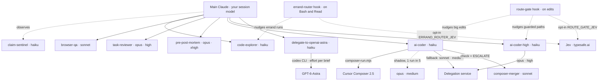

# efficient-claude-harness

A Claude Code plugin marketplace with one plugin, `ech`: a set of agents, skills and hooks that keep the main conversation small by sending work to the cheapest lane that can do it.
Every component is namespaced, so the agents appear as `ech:ai-coder`, `ech:code-explorer`, `ech:browser-qa`, and so on.



Labels read `agent · model · effort`.
Dotted arrows from the two hooks are notes added to Claude's context, never an automatic call; the Jev arrows exist only when you opt in.
Agents with no effort run at the default; Haiku has no effort setting.
The `haiku` lanes are thin wrappers: the model on the arrow does the real work.

## What is inside

| Component | Kind | What it does |
| --- | --- | --- |
| `ech:ai-coder` | agent (haiku) | Default coding lane: briefs Cursor Composer 2.5, runs it in place, runs a deterministic check, commits nothing; falls back to the delegation service. |
| `ech:ai-coder-high` | agent (haiku) | Guarded lane for migrations, auth, payments, secrets, CI and git hooks: needs a written plan, sends the job to the delegation service at `opus`/`high`, or runs locally when the job needs the live repository. |
| `ech:composer-merger` | agent (sonnet) | Spawned only when the check returns `ESCALATE` (tests pass but the diff touched tests): looks for weakened assertions and re-runs the tests. Never commits. |
| `ech:code-explorer` | agent (haiku) | Returns `file:line` hits and nothing else. |
| `ech:browser-qa` | agent (sonnet) | Opens the app in a real browser with `@playwright/cli`, interacts, screenshots, and reports PASS/FAIL per check. Local hosts only. |
| `ech:task-reviewer` | agent (opus) | Read-only reviewer that judges a finished task against its brief. |
| `ech:pre-post-mortem` | agent (opus, xhigh) + command `/ech:pre-post-mortem` | Runs the pre-post-mortem risk ritual before a risky or hard-to-reverse change: imagines it already failed, traces each risk to weeks and months out, then attacks its own analysis. Expensive; for risky changes only. |
| `ech:claim-sentinel` | observer agent (haiku) | Watches the main loop and flags success claims made without a ground-truth check. |
| `ech:delegate-to-openai-astra` | agent + skill | Forwards one task to OpenAI GPT-6-Astra through the Codex CLI and returns its answer verbatim. Triggers only when you name Astra. |
| `ech:delegate-heavy-reasoning` | skill | How to send a job to the delegation service and apply the patch safely. |
| `/ech:delegate-to-external-ai` | command | The before-and-after checklist for a delegation-service job. |
| `route-gate` | hook (PreToolUse on edits) | Notices when the main thread is hand-writing a Composer-sized code change and suggests `ech:ai-coder`. Guarded paths (migrations, CI, secrets, git hooks including `.githooks/`) are gated whatever their extension. Warn-only by default. |
| `errand-router` | hook (PreToolUse on Bash and Read) | Notices runs of three or more read-only errands in the main thread and suggests handing the run to `ech:code-explorer`. Warn-only by default. |

The scripts the agents call live in `plugins/ech/scripts/`: `composer-run.mjs`, `remote-run.mjs`, `delegate.mjs`, `astra.mjs` and `openai-gpt-reviewer.mjs`.
They need only Node; there are no npm dependencies.

## Install

Inside Claude Code:

```
/plugin marketplace add gmorel/efficient-claude-harness
/plugin install ech@efficient-claude-harness
```

For a team repository, register the marketplace in the project's shared settings so every collaborator is offered it:

```bash
claude plugin marketplace add gmorel/efficient-claude-harness --scope project
claude plugin install ech@efficient-claude-harness --scope project
```

The plugin has no `version` field on purpose: each commit counts as a new version, so users track the repository rather than release numbers.

## Prerequisites, per lane

Install only what the lanes you use need.

| Lane | Needs |
| --- | --- |
| Everything | Node 18 or later on `PATH`. |
| `ai-coder` (Composer) | `cursor-agent` on `PATH` and a Cursor account with Composer 2.5: install from cursor.com, then run `cursor-agent login` yourself. Check with `node <plugin>/scripts/composer-run.mjs doctor`. |
| `ai-coder` / `ai-coder-high` with `opus@<effort>` | The `claude` CLI on `PATH`, logged in. |
| `ai-coder-high` with `codex@<effort>`, and `openai-gpt-reviewer.mjs` | The OpenAI `codex` Claude Code plugin installed, and a Codex login. |
| Delegation service (`remote-run.mjs`, `delegate.mjs`) | Your own delegation-service deployment and its key, in `~/.config/claude-delegate/config.json` (see below). |
| `delegate-to-openai-astra` | The `codex` CLI on `PATH`, logged in to an OpenAI account with access to GPT-6-Astra. |
| `browser-qa` | Network access to npm the first time (`npx -y @playwright/cli@0.1.22`), and a browser; if none is found the agent runs `npx playwright install chromium` once. |
| `claim-sentinel` | `CLAUDE_CODE_EXPERIMENTAL_OBSERVER_AGENTS=1` in your environment or settings `env`, and the attach step below. |

### Delegation-service configuration

Every person uses their own delegation-service account and their own key.
Never share a key or reuse someone else's: the service runs jobs on the account behind the key, and Anthropic's consumer terms forbid making an account available to anyone else.
Without your own `config.json`, the delegation lane does not run.

Create `~/.config/claude-delegate/config.json` yourself, readable only by you (`chmod 600`):

```json
{ "baseUrl": "https://…", "apiKey": "<your key>" }
```

`DELEGATE_CONFIG` points the scripts at a different file.
Never commit this file and never paste the key into a prompt.

### Attaching claim-sentinel

Observer agents are an experimental Claude Code feature, and the plugin documentation does not list `observer:` among the frontmatter fields a plugin agent supports.
So this plugin ships the observer but does not ship a main agent that hosts it, and it does not set a main-thread agent for you (that would silently replace your own).
To use it, add these two lines to the frontmatter of the agent you run as your main thread, for example `~/.claude/agents/main.md`:

```yaml
observer: ech:claim-sentinel
observerMessage: Name the exact claim this turn asserted without a ground-truth check in this session, plus the exact artifact that would settle it. Specific claim or silence.
```

Then select that agent as your main thread (`"agent": "main"` in `~/.claude/settings.json`, or `claude --agent main`) and set `CLAUDE_CODE_EXPERIMENTAL_OBSERVER_AGENTS=1`.
The plugin-scoped name `ech:claim-sentinel` in `observer:` has not been tested yet; if it does not attach, copy `plugins/ech/agents/claim-sentinel.md` into `~/.claude/agents/` and use `observer: claim-sentinel`.
The observer costs tokens on every turn, so many people enable it only for risky sessions.

## Where runtime data goes

Logs and ledgers (`runs.jsonl`, `delegate.jsonl`, `routing.jsonl`, `errand-router.jsonl`, shadow-run patch pairs, Astra job state) go to the plugin data directory, `~/.claude/plugins/data/ech-efficient-claude-harness/`.
Claude Code deletes that directory when you uninstall the plugin, unless you pass `--keep-data`.
To keep the history somewhere durable, set `HARNESS_DATA_DIR` to a directory of your choice, or override individual files with `COMPOSER_LANE_LOG`, `DELEGATE_LEDGER`, `ROUTING_LEDGER` and `ERRAND_ROUTER_LEDGER`.
When neither variable is available (for example when you run a script by hand), the scripts fall back to `~/.claude/harness-data/`.
`DELEGATE_CMD` replaces the delegation client script, which is useful for tests.

## Hooks and their switches

Both hooks only ever add a note to Claude's context by default; neither blocks anything unless you opt in.

| Hook | Off | Warn (default) | Block |
| --- | --- | --- | --- |
| `route-gate` | `ROUTE_GATE=off` | `ROUTE_GATE=warn` | `ROUTE_GATE=deny`, or `{"mode":"deny"}` in `<data>/route-gate.json` |
| `errand-router` | `ERRAND_ROUTER=off`, or create `<data>/errand-router.off` | `ERRAND_ROUTER=warn` | `ERRAND_ROUTER=block` (denies from the fifth errand in a row) |

`route-gate` stays silent in subagents, in non-interactive sessions, outside git repositories, and when `cursor-agent` is missing; its thresholds (`maxLines`, `guardedMaxLines`, `maxFilesPerPrompt`) live in `<data>/route-gate.json`.
`ROUTE_GATE_CONFIG` points `route-gate` at a config file of your choice, and an existing `~/.claude/composer-lane/route-gate.json` works as is.
`errand-router` stays silent in subagents and for the eight errands after a helper returns, so you can check what the helper claimed; `ERRAND_ROUTER_LANE` changes the agent it suggests.
To turn both off without uninstalling, disable the plugin with `/plugin`.

### Jev classification for `errand-router` (opt-in)

`ERRAND_ROUTER_JEV=1` together with a key (see below) turns on the Jev classification: from the third errand in a row, `errand-router` asks Jev (typesafe.ai) which helper lane should run the call.
It nudges only when Jev names a lane other than the main thread with a confidence of at least 0.80 (`ERRAND_ROUTER_MIN_CONF`), and it gives Jev 1500 ms (`ERRAND_ROUTER_TIMEOUT_MS`).
The key is read from the `TYPESAFE_AI_JEV_API_KEY` environment variable, or, only when that is empty and `JEV_ENV_FILE` names a file, from the `TYPESAFE_AI_JEV_API_KEY=` line of that file; it is never printed, logged or written.
`JEV_URL` overrides the endpoint, which defaults to `https://api.typesafe.ai/v1/systemone`.
`ERRAND_ROUTER_LANES` overrides the lane table, as a JSON object that maps a lane key to its description, for example `{"explore":"Explore: searches or reads several repository files.","main":"main thread, keep it here."}`.
The `main` lane is always kept, and a missing or invalid `ERRAND_ROUTER_LANES` falls back to the owner's `lanes` from `ERRAND_ROUTER_CONFIG`, then to the generic table (`explore` and `main`).
`ERRAND_ROUTER_CONFIG` names a JSON file with the owner's values, read once at start, with an absolute path. Every key is optional: `lanes` (lane key to description), `how` (the Jev HOW text), `sshHosts` (hosts whose `ssh <host> …` calls count as errands in Jev mode) and `liveRunWords` (script names whose `node … <word>` call, run over ssh, stays in the main thread in Jev mode).
A missing or unreadable file means the generic defaults, with no error. The plugin ships no host or lane names of its own.
A lane other than `explore` and `main` is offered to Jev only when its agent file exists in `~/.claude/agents/` or in the nearest `.claude/agents/` above the working directory.
Half the sessions are a silent control group by default, in Jev mode and out of it, as in the original (logged as `would-warn`). `ERRAND_ROUTER_HOLDOUT=0` nudges every session.
In Jev mode the `sshHosts` and `liveRunWords` of `ERRAND_ROUTER_CONFIG` apply: an `ssh <host>` call counts as an errand, and a live run over ssh stays in the main thread.
Without `ERRAND_ROUTER_JEV=1` there is no network call at all, and the Jev client is not even loaded.
A Jev failure (no answer, timeout, HTTP error, unreadable body) never blocks a tool call: the hook stays silent.
`ROUTE_GATE_AGENT_PREFIX` sets the agent name in `route-gate` messages and its ledger, and its default is `ech:`.
Set it to an empty value (`ROUTE_GATE_AGENT_PREFIX=`) to get the original messages byte for byte, naming `ai-coder` and `ai-coder-high`.
Only the owner's parity profile sets it to empty, inside its sandbox; a real install keeps the default `ech:`, because the agents load as `ech:ai-coder` and `ech:ai-coder-high`.

### Jev classification for `route-gate` (opt-in)

`ROUTE_GATE_JEV=1` together with a Jev key (the same key rules as `errand-router` above) turns on the Jev coder mode.
It changes nothing for small edits: Jev is asked only after the fixed rules already decided to nudge or block (`size` or `many_files`).
Jev picks one lane: `ai-coder`, `ai-coder-high` or `main` (keep the edit in the main session).
A guarded path always stays on `ai-coder-high`, whatever Jev says.
Jev can move an ordinary path up to `ai-coder-high`.
In warn mode, `main` removes the nudge; in deny mode, `main` never lifts the block.
A confidence under 0.80 (`ROUTE_GATE_JEV_MIN_CONF`), a timeout of 1500 ms (`ROUTE_GATE_JEV_TIMEOUT_MS`) or any error keeps the fixed-rule result.
By default only metadata goes to Jev: tool, file extension, path relative to the git root, line counts, file count and the guarded flag.
`ROUTE_GATE_JEV_SEND_TEXT=1` also sends up to 400 characters of the new code, after a best-effort secret redaction; turn it on only if you accept that code leaves your machine.
In Jev mode the ledger record gains `jev_lane`, `jev_conf`, `jev_ms` and `jev_action`; without it, output and ledger are unchanged.

### Parity check against the original hooks

`node tests/parity/run.mjs` runs the original hooks under `~/.claude/hooks/` and the plugin hooks on the same inputs in a temp sandbox, and prints one table row per case.
`--profile default` or `--profile owner` runs one profile; the owner profile turns Jev mode on with a dummy key against a local stub, and must show no difference at all.
Both profiles read the owner config (`ERRAND_ROUTER_CONFIG`, default `~/.config/harness/errand-router.json`) to build their inputs, and the owner profile hands that file to the plugin hook.
The owner profile must show zero DIFF and has no allowlist entries; it sets `ROUTE_GATE_AGENT_PREFIX` to empty for the plugin hooks, as the owner's real environment must.
The default profile may show ALLOWED rows, each with its reason printed under the table; any other difference is a DIFF.
The output is compared raw: the only rename of `ech:ai-coder` to `ai-coder` is a scoped allowlist rule for `route-gate` in the default profile.
A PLUGIN-ONLY section after the table runs the one check that needs the owner config (the config file set to the owner's), and prints PASS or FAIL; the other plugin checks are in `tests/plugin/run.mjs`.
It exits 1 on any unexplained difference, any failed plugin check, or any line the test itself wrote to a real ledger under `~/.claude`: a line with the test's synthetic session ids or its temp path.
Lines another session appends to those ledgers during a run are printed as `REAL LEDGER info` and never fail the run, so the check works while other sessions are active. `tests/plugin/ledger-guard.test.mjs` checks the split.
`ERRAND_ROUTER_LANES` and `ROUTE_GATE_AGENT_PREFIX` are documented in the headers of `plugins/ech/hooks/errand-router.mjs` and `plugins/ech/hooks/route-gate.mjs`.
The plugin's `route-gate` now runs the `lane_missing` check like the original: an unguarded edit with no `cursor-agent` is logged as `lane_missing` and gets no note.

## Tests

`node tests/plugin/run.mjs` checks the plugin hooks alone and needs only node and git.
It reads no `~/.claude/hooks` original and no owner config, so `env -u ERRAND_ROUTER_CONFIG HOME="$(mktemp -d)" node tests/plugin/run.mjs` must exit 0.
`node tests/parity/run.mjs` is the owner-only parity tool against the original hooks, and it exits 3 without `~/.config/harness/errand-router.json`.

AI agents that work on this repository follow [AGENTS.md](AGENTS.md); it holds the test commands, the invariants and the git rules.

## Security notes

The coding scripts strip credential-shaped environment variables before spawning an engine, and `remote-run.mjs` refuses to send `.env` files, keys and files that contain secret-shaped strings.
`delegate.mjs` sends the files you name to the delegation service you configured, and nowhere else.
`browser-qa` is restricted by its instructions to local development hosts and test data from the project's own fixtures.

## License

MIT. See [LICENSE](LICENSE).
