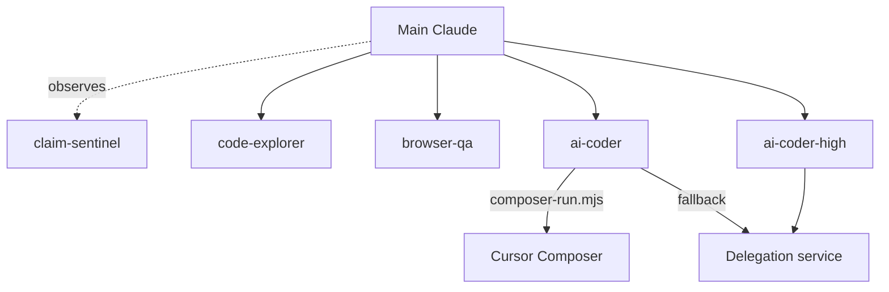

# efficient-claude-harness

A Claude Code plugin marketplace with one plugin, `harness`: a set of agents, skills and hooks that keep the main conversation small by sending work to the cheapest lane that can do it.
Every component is namespaced, so the agents appear as `harness:ai-coder`, `harness:code-explorer`, `harness:browser-qa`, and so on.



## What is inside

| Component | Kind | What it does |
| --- | --- | --- |
| `harness:ai-coder` | agent (haiku) | Default coding lane: briefs Cursor Composer 2.5, runs it in place, runs a deterministic check, commits nothing; falls back to the delegation service. |
| `harness:ai-coder-high` | agent (haiku) | Guarded lane for migrations, auth, payments, secrets, CI and git hooks: needs a written plan, sends the job to the delegation service at `opus`/`high`, or runs locally when the job needs the live repository. |
| `harness:composer-merger` | agent (sonnet) | Spawned only when the check returns `ESCALATE` (tests pass but the diff touched tests): looks for weakened assertions and re-runs the tests. Never commits. |
| `harness:code-explorer` | agent (haiku) | Returns `file:line` hits and nothing else. |
| `harness:browser-qa` | agent (sonnet) | Opens the app in a real browser with `@playwright/cli`, interacts, screenshots, and reports PASS/FAIL per check. Local hosts only. |
| `harness:task-reviewer` | agent (opus) | Read-only reviewer that judges a finished task against its brief. |
| `harness:claim-sentinel` | observer agent (haiku) | Watches the main loop and flags success claims made without a ground-truth check. |
| `harness:delegate-to-openai-astra` | agent + skill | Forwards one task to OpenAI GPT-6-Astra through the Codex CLI and returns its answer verbatim. Triggers only when you name Astra. |
| `harness:delegate-heavy-reasoning` | skill | How to send a job to the delegation service and apply the patch safely. |
| `/harness:delegate-to-external-ai` | command | The before-and-after checklist for a delegation-service job. |
| `route-gate` | hook (PreToolUse on edits) | Notices when the main thread is hand-writing a Composer-sized code change and suggests `harness:ai-coder`. Warn-only by default. |
| `errand-router` | hook (PreToolUse on Bash and Read) | Notices runs of three or more read-only errands in the main thread and suggests handing the run to `harness:code-explorer`. Warn-only by default. |

The scripts the agents call live in `plugins/harness/scripts/`: `composer-run.mjs`, `remote-run.mjs`, `delegate.mjs`, `astra.mjs` and `openai-gpt-reviewer.mjs`.
They need only Node; there are no npm dependencies.

## Install

Inside Claude Code:

```
/plugin marketplace add gmorel/efficient-claude-harness
/plugin install harness@efficient-claude-harness
```

For a team repository, register the marketplace in the project's shared settings so every collaborator is offered it:

```bash
claude plugin marketplace add gmorel/efficient-claude-harness --scope project
claude plugin install harness@efficient-claude-harness --scope project
```

The repository is private for now, so each user needs read access to it on GitHub.
The plugin has no `version` field on purpose: each commit counts as a new version, so users track the repository rather than release numbers.

## Prerequisites, per lane

Install only what the lanes you use need.

| Lane | Needs |
| --- | --- |
| Everything | Node 18 or later on `PATH`. |
| `ai-coder` (Composer) | `cursor-agent` on `PATH` and a Cursor account with Composer 2.5: install from cursor.com, then run `cursor-agent login` yourself. Check with `node <plugin>/scripts/composer-run.mjs doctor`. |
| `ai-coder` / `ai-coder-high` with `opus@<effort>` | The `claude` CLI on `PATH`, logged in. |
| `ai-coder-high` with `codex@<effort>`, and `openai-gpt-reviewer.mjs` | The OpenAI `codex` Claude Code plugin installed, and a Codex login. |
| Delegation service (`remote-run.mjs`, `delegate.mjs`) | Your own delegation-service deployment and its key, in `~/.config/claude-delegate/config.json` (see below). |
| `delegate-to-openai-astra` | The `codex` CLI on `PATH`, logged in to an OpenAI account with access to GPT-6-Astra. |
| `browser-qa` | Network access to npm the first time (`npx -y @playwright/cli@0.1.22`), and a browser; if none is found the agent runs `npx playwright install chromium` once. |
| `claim-sentinel` | `CLAUDE_CODE_EXPERIMENTAL_OBSERVER_AGENTS=1` in your environment or settings `env`, and the attach step below. |

### Delegation-service configuration

Every person uses their own delegation-service account and their own key.
Never share a key or reuse someone else's: the service runs jobs on the account behind the key, and Anthropic's consumer terms forbid making an account available to anyone else.
Without your own `config.json`, the delegation lane does not run.

Create `~/.config/claude-delegate/config.json` yourself, readable only by you (`chmod 600`):

```json
{ "baseUrl": "https://…", "apiKey": "<your key>" }
```

`DELEGATE_CONFIG` points the scripts at a different file.
Never commit this file and never paste the key into a prompt.

### Attaching claim-sentinel

Observer agents are an experimental Claude Code feature, and the plugin documentation does not list `observer:` among the frontmatter fields a plugin agent supports.
So this plugin ships the observer but does not ship a main agent that hosts it, and it does not set a main-thread agent for you (that would silently replace your own).
To use it, add these two lines to the frontmatter of the agent you run as your main thread, for example `~/.claude/agents/main.md`:

```yaml
observer: harness:claim-sentinel
observerMessage: Name the exact claim this turn asserted without a ground-truth check in this session, plus the exact artifact that would settle it. Specific claim or silence.
```

Then select that agent as your main thread (`"agent": "main"` in `~/.claude/settings.json`, or `claude --agent main`) and set `CLAUDE_CODE_EXPERIMENTAL_OBSERVER_AGENTS=1`.
The plugin-scoped name `harness:claim-sentinel` in `observer:` has not been tested yet; if it does not attach, copy `plugins/harness/agents/claim-sentinel.md` into `~/.claude/agents/` and use `observer: claim-sentinel`.
The observer costs tokens on every turn, so many people enable it only for risky sessions.

## Where runtime data goes

Logs and ledgers (`runs.jsonl`, `delegate.jsonl`, `routing.jsonl`, `errand-router.jsonl`, shadow-run patch pairs, Astra job state) go to the plugin data directory, `~/.claude/plugins/data/harness-efficient-claude-harness/`.
Claude Code deletes that directory when you uninstall the plugin, unless you pass `--keep-data`.
To keep the history somewhere durable, set `HARNESS_DATA_DIR` to a directory of your choice, or override individual files with `COMPOSER_LANE_LOG`, `DELEGATE_LEDGER`, `ROUTING_LEDGER` and `ERRAND_ROUTER_LEDGER`.
When neither variable is available (for example when you run a script by hand), the scripts fall back to `~/.claude/harness-data/`.
`DELEGATE_CMD` replaces the delegation client script, which is useful for tests.

## Hooks and their switches

Both hooks only ever add a note to Claude's context by default; neither blocks anything unless you opt in.

| Hook | Off | Warn (default) | Block |
| --- | --- | --- | --- |
| `route-gate` | `ROUTE_GATE=off` | `ROUTE_GATE=warn` | `ROUTE_GATE=deny`, or `{"mode":"deny"}` in `<data>/route-gate.json` |
| `errand-router` | `ERRAND_ROUTER=off`, or create `<data>/errand-router.off` | `ERRAND_ROUTER=warn` | `ERRAND_ROUTER=block` (denies from the fifth errand in a row) |

`route-gate` stays silent in subagents, in non-interactive sessions, outside git repositories, and when `cursor-agent` is missing; its thresholds (`maxLines`, `guardedMaxLines`, `maxFilesPerPrompt`) live in `<data>/route-gate.json`.
`errand-router` stays silent in subagents and for the eight errands after a helper returns, so you can check what the helper claimed; `ERRAND_ROUTER_LANE` changes the agent it suggests.
To turn both off without uninstalling, disable the plugin with `/plugin`.

## Security notes

The coding scripts strip credential-shaped environment variables before spawning an engine, and `remote-run.mjs` refuses to send `.env` files, keys and files that contain secret-shaped strings.
`delegate.mjs` sends the files you name to the delegation service you configured, and nowhere else.
`browser-qa` is restricted by its instructions to local development hosts and test data from the project's own fixtures.

## License

No license has been chosen yet.
Until one is added, all rights are reserved by the author; ask before reusing the code outside your own setup.
