# claim-check

Material about the claim-check concept that is not part of any Claude plugin.
Not a plugin: nothing here is installed by `/plugin install`, and nothing here is read by a plugin.
The real code is [`plugins/ech-claim-check`](../plugins/ech-claim-check); when this page and that code disagree, the code is right.

## The concept

An agent often says "fixed", "tests pass", "saved" or "5/5" without having checked it.
Claim-check catches that at the end of the turn, before the claim leaves the turn.
It does not verify anything itself: it asks the agent to verify, or to say the claim is unverified.

## What the plugin does

When the main session ends its turn (`Stop`) or any subagent ends its turn (`SubagentStop`), a hook reads the final text.
A stop that was already re-prompted (`stop_hook_active`) is let through, so the hook blocks at most once per turn.
A report from the `claim-sentinel` observer is never checked.
A regex gate lets through, with no model call, any text under 8 characters or with no claim word ("passed", "fixed", "saved", "verified", "done", a count such as "5/5", and a few French ones).
Otherwise Haiku, at low effort with a 200-token cap and a 20-second timeout, reads the final text, the last 30 tool calls of this turn and the one before, and the generic rules.
When a project rules file exists (`.claude/claim-check-rules.md` in the project by default, or the `rulesFile` option), its text is appended, cut at 4,000 characters.
Haiku answers one line of JSON: `{"flag":false}`, or `{"flag":true}` with the claim and the check that would settle it.
On a flag the hook returns a block, and the agent is re-prompted in the same turn to check that artifact or restate the claim as unverified.
On no flag, and on any error, timeout or unreadable answer, the stop goes through: the hook fails open.
Every decision, except the claim-sentinel skip, is one JSON line in the `ech-claim-check.jsonl` ledger, under `$HARNESS_DATA_DIR` when it is set.

The plugin also ships `claim-sentinel`, an opt-in observer agent on Haiku that reads each turn and reports unverified claims without blocking.
Nothing runs it until you opt in; the plugin README says how.

## What is here

- `flow-animation/` builds the animated diagram above into `docs/claim-check-flow.svg`, and tests the generator.
