# codex-review

Material about the `ech-codex-review` plugin that is not part of any Claude plugin.
Not a plugin: nothing here is installed by /plugin install, and nothing here is read by a plugin.
The real code is in [`plugins/ech-codex-review`](../plugins/ech-codex-review).

## What the concept is

Every Claude reviewer shares the same blind spots, so this plugin asks a second model family, OpenAI through Codex, to review the work.
The value is independent failure modes, so the answer comes back verbatim and is never paraphrased.
Every answer is labelled ADVISORY: a reason to re-examine the code, never a reason to change it on its own.

## Read-only, always

Nothing in the plugin can write: no `--write`, no `codex-rescue`, no `transfer`.
`astra.mjs` refuses `--write` with exit 2, and Astra runs under `codex exec --sandbox read-only`.
`openai-gpt-reviewer.mjs` never passes `--write` to the Codex plugin's runtime.
`plugins/ech-codex-review/tests/read-only.test.mjs` checks every shipped file for a write mode.
Both scripts strip credential-shaped variables from the environment before they launch Codex.

## What it does

- `sol-reviewer` and `openai-gpt-diff-reviewer` take a diff as a file, hand it to Codex for an adversarial review, and return the findings verbatim.
- `openai-gpt-plan-reviewer` hands an already-written plan for irreversible work to Codex and returns the critique verbatim.
- `delegate-to-openai-astra` (agent and skill) forwards one task to GPT-6-Astra, only when the user names Astra; every line Astra writes comes back stamped.
- The `codex-first-pr-review` skill reviews a PR head in three steps.
- Step 1: Codex reads the whole diff first, through `sol-reviewer`, from a `git archive` export of the head.
- Step 2: a fresh read-only reviewer, with no memory of step 1, checks only Codex's findings and the project's invariants.
- Step 3: the verdict, `CLEAR` or `NOT CLEAR`, with the findings kept, the findings dropped and why, and what was not run.
- The invariants come from `.claude/pr-review-invariants.md` or the `Invariants` section of `AGENTS.md`; if neither exists the reviewer asks and never invents them.
- No agent runs on its own initiative: each runs only when explicitly asked.
- If Codex fails or times out, the report carries a stamp ("reviewed WITHOUT cross-model pass", "planned WITHOUT cross-model pass" or "no Astra pass") instead of skipping silently.

## What is here

- `flow-animation/` builds the animated SVG above into `docs/codex-review-flow.svg`, and tests it.
