# context

Material about the ech-context concept that is not part of any Claude plugin.
Not a plugin: nothing here is installed by /plugin install, and nothing here is read by a plugin.
The real code is in [`plugins/ech-context`](../plugins/ech-context).

## The idea

A long session re-reads its whole context on every turn, so past a certain size most of each turn's cost is that re-read.
An automatic compaction shrinks the context, but its summary can drop what the session acts on.
ech-context adds two hooks: one tells you how big the session is, the other tells the compaction what to keep.

## session-size, on every prompt (UserPromptSubmit)

It reads the newest main-thread token usage from the end of the transcript: input plus cache-creation plus cache-read tokens, or the size after the last compaction.
At or above `SESSION_SIZE_LIMIT` (default 200000 tokens) it shows you a line with the size and the limit, and adds a hint for Claude.
The hint is information only: Claude is told to do your request in full and not to mention the size unless you ask.
It fires at most once per `SESSION_SIZE_STEP` (default 50000 tokens) of growth; once the context falls more than one step below where it last fired, after a compaction, it is armed again.
It never refuses a prompt, and it skips subagent prompts.

## compact-guard, around a compaction (PreCompact, SessionStart `compact`)

Before an automatic compaction of the main session, it tells the summary to keep, verbatim under a "MUST SURVIVE" heading, the resume notes, the hold rules in force, the in-flight jobs, your unfinished requests, any live run, the uncommitted files and the last commit.
A subagent's automatic compaction gets its own list: the brief, the files changed, the evidence gathered and what is left to do.
A manual compaction is only logged; nothing is added.
When the main session resumes after that automatic compaction, within 30 minutes, it adds a recovery line once: re-read the resume note and the hold rules before any push, tag, deploy, live run or message to another lane.

## Switches and safety

- `SESSION_SIZE=off` and `COMPACT_GUARD=off`, or a `session-size.off` or `compact-guard.off` file in the data directory, switch each hook off.
- The data directory is `HARNESS_DATA_DIR`, else the plugin data directory; the ledgers there are `session-size.jsonl` and `compact.jsonl`.
- Both hooks fail open: a crash exits 0 and prints nothing, and each hook has a 10 second timeout.
- Neither hook edits your settings.

## What is here

- `flow-animation/` builds the animated diagram above into `docs/context-flow.svg`, and tests the generator.
