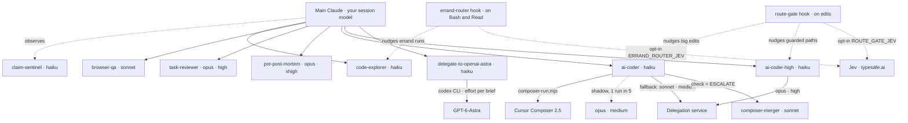
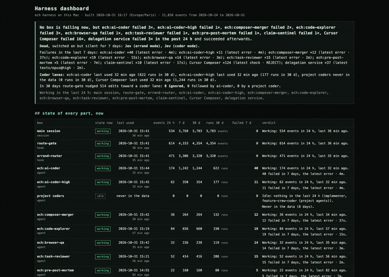

# Reference

Everything the [README](../README.md) leaves out. Nothing here is needed to install the plugin or to use it on defaults.

## Delegation-service configuration

Every person uses their own delegation-service account and their own key.
Never share a key or reuse someone else's: the service runs jobs on the account behind the key, and Anthropic's consumer terms forbid making an account available to anyone else.
Without your own `config.json`, the delegation lane does not run.

Create `~/.config/claude-delegate/config.json` yourself, readable only by you (`chmod 600`):

```json
{ "baseUrl": "https://…", "apiKey": "<your key>" }
```

`DELEGATE_CONFIG` points the scripts at a different file, and `DELEGATE_CMD` replaces the client script, which is useful for tests.
Never commit this file and never paste the key into a prompt.

## Attaching claim-sentinel

Observer agents are an experimental Claude Code feature, and the plugin documentation does not list `observer:` among the frontmatter fields a plugin agent supports.
So this plugin ships the observer but does not ship a main agent that hosts it, and it does not set a main-thread agent for you — that would silently replace your own.

Add these two lines to the frontmatter of the agent you run as your main thread, for example `~/.claude/agents/main.md`:

```yaml
observer: ech:claim-sentinel
observerMessage: Name the exact claim this turn asserted without a ground-truth check in this session, plus the exact artifact that would settle it. Specific claim or silence.
```

Then select that agent as your main thread (`"agent": "main"` in `~/.claude/settings.json`, or `claude --agent main`) and set `CLAUDE_CODE_EXPERIMENTAL_OBSERVER_AGENTS=1`.
The plugin-scoped name `ech:claim-sentinel` in `observer:` has not been tested yet; if it does not attach, copy `plugins/ech/agents/claim-sentinel.md` into `~/.claude/agents/` and use `observer: claim-sentinel`.
The observer costs tokens on every turn, so many people enable it only for risky sessions.

## Hook details

`route-gate` stays silent in subagents, in non-interactive sessions, outside git repositories, and when `cursor-agent` is missing.
Its thresholds (`maxLines`, `guardedMaxLines`, `maxFilesPerPrompt`) live in `<data>/route-gate.json`; `ROUTE_GATE_CONFIG` points it at a file of your choice, and an existing `~/.claude/composer-lane/route-gate.json` works as is.
An unguarded edit with no `cursor-agent` is logged as `lane_missing` and gets no note.

`errand-router` stays silent in subagents and for the eight errands after a helper returns, so you can check what the helper claimed.
`ERRAND_ROUTER_LANE` changes the agent it suggests.
Half the sessions are a silent control group by default, in Jev mode and out of it, logged as `would-warn`; `ERRAND_ROUTER_HOLDOUT=0` nudges every session.

`ROUTE_GATE_AGENT_PREFIX` sets the agent name in `route-gate` messages and its ledger; the default is `ech:`.
An empty value gives the original messages byte for byte, naming `ai-coder` and `ai-coder-high`. Only the owner's parity profile sets it empty, inside its sandbox.

## Jev classification (opt-in, both hooks)

Jev (typesafe.ai) is a fast classifier the two hooks can consult instead of relying on their fixed rules alone.
Without `ERRAND_ROUTER_JEV=1` or `ROUTE_GATE_JEV=1` there is no network call at all and the Jev client is not even loaded.
A Jev failure — no answer, timeout, HTTP error, unreadable body — never blocks a tool call: the fixed-rule result stands.

The key is read from `TYPESAFE_AI_JEV_API_KEY`, or, only when that is empty and `JEV_ENV_FILE` names a file, from the `TYPESAFE_AI_JEV_API_KEY=` line of that file. It is never printed, logged or written.
`JEV_URL` overrides the endpoint, which defaults to `https://api.typesafe.ai/v1/systemone`.

### `errand-router`

From the third errand in a row, the hook asks Jev which helper lane should run the call.
It nudges only when Jev names a lane other than the main thread with a confidence of at least 0.80 (`ERRAND_ROUTER_MIN_CONF`), and it gives Jev 1500 ms (`ERRAND_ROUTER_TIMEOUT_MS`).

`ERRAND_ROUTER_LANES` overrides the lane table, as a JSON object mapping a lane key to its description, for example `{"explore":"Explore: searches or reads several repository files.","main":"main thread, keep it here."}`.
The `main` lane is always kept. A missing or invalid value falls back to the owner's `lanes` from `ERRAND_ROUTER_CONFIG`, then to the generic table (`explore` and `main`).
A lane other than `explore` and `main` is offered to Jev only when its agent file exists in `~/.claude/agents/` or in the nearest `.claude/agents/` above the working directory.

`ERRAND_ROUTER_CONFIG` names a JSON file with the owner's values, read once at start, with an absolute path. Every key is optional: `lanes`, `how` (the Jev HOW text), `sshHosts` (hosts whose `ssh <host> …` calls count as errands in Jev mode) and `liveRunWords` (script names whose `node … <word>` call, run over ssh, stays in the main thread in Jev mode).
A missing or unreadable file means the generic defaults, with no error. The plugin ships no host or lane names of its own.

The command text sent to Jev is the first 500 characters, redacted before it is cut.

### `route-gate`

Jev is asked only after the fixed rules already decided to nudge or block (`size` or `many_files`), so small edits are unaffected.
It picks one lane: `ai-coder`, `ai-coder-high` or `main` (keep the edit in the main session).
A guarded path always stays on `ai-coder-high`, whatever Jev says; Jev can move an ordinary path up to `ai-coder-high`.
In warn mode, `main` removes the nudge; in deny mode, `main` never lifts the block.
A confidence under 0.80 (`ROUTE_GATE_JEV_MIN_CONF`), a timeout of 1500 ms (`ROUTE_GATE_JEV_TIMEOUT_MS`) or any error keeps the fixed-rule result.

By default only metadata goes to Jev: tool, file extension, path relative to the git root, line counts, file count and the guarded flag.
`ROUTE_GATE_JEV_SEND_TEXT=1` also sends up to 400 characters of the new code, after a best-effort secret redaction, redacted before it is cut. Turn it on only if you accept that code leaves your machine.

In Jev mode the ledger record gains `jev_lane`, `jev_conf`, `jev_ms` and `jev_action`; without it, output and ledger are unchanged.

## Parity check against the original hooks

`node tests/parity/run.mjs` runs the original hooks under `~/.claude/hooks/` and the plugin hooks on the same inputs in a temp sandbox, and prints one table row per case.
It is owner-only and exits 3 without `~/.config/harness/errand-router.json`.

`--profile default` or `--profile owner` runs one profile.
Both profiles read the owner config (`ERRAND_ROUTER_CONFIG`) to build their inputs, and the owner profile hands that file to the plugin hook.
The owner profile turns Jev mode on with a dummy key against a local stub, must show zero DIFF, has no allowlist entries, and sets `ROUTE_GATE_AGENT_PREFIX` to empty for the plugin hooks, as the owner's real environment must.
The default profile may show ALLOWED rows, each with its reason printed under the table; any other difference is a DIFF.
The output is compared raw: the only rename of `ech:ai-coder` to `ai-coder` is a scoped allowlist rule for `route-gate` in the default profile.

A PLUGIN-ONLY section after the table runs the one check that needs the owner config, and prints PASS or FAIL; the other plugin checks are in `tests/plugin/run.mjs`.
It exits 1 on any unexplained difference, any failed plugin check, or any line the test itself wrote to a real ledger under `~/.claude` — a line with the test's synthetic session ids or its temp path.
Lines another session appends to those ledgers during a run are printed as `REAL LEDGER info` and never fail the run, so the check works while other sessions are active. `tests/plugin/ledger-guard.test.mjs` checks the split.

<!-- Moved here from the main README so the README stays short. -->

## How work flows



Labels read `agent · model · effort`; the `haiku` lanes are thin wrappers, and the model on the arrow does the real work.
Dotted arrows from the two hooks are notes added to Claude's context, never an automatic call. The Jev arrows exist only when you opt in.

## What is inside

| Component | Kind | What it does |
| --- | --- | --- |
| `ech:ai-coder` | agent | Default coding lane: briefs Cursor Composer 2.5, runs it in place, checks the result, commits nothing. Falls back to the delegation service. |
| `ech:ai-coder-high` | agent | Guarded lane — migrations, auth, payments, secrets, CI, git hooks. Needs a written plan; runs at `opus`/`high`. |
| `ech:composer-merger` | agent | Only on `ESCALATE` (tests pass but the diff touched tests): looks for weakened assertions and re-runs them. |
| `ech:code-explorer` | agent | Returns `file:line` hits and nothing else. |
| `ech:browser-qa` | agent | Drives a real browser, screenshots, reports PASS/FAIL per check. Local hosts only. |
| `ech:task-reviewer` | agent | Read-only: judges a finished task against its brief. |
| `ech:pre-post-mortem` | agent + command | Imagines a risky change already failed and works backwards. Expensive; risky changes only. |
| `ech:claim-sentinel` | observer | Flags success claims made without a ground-truth check. |
| `ech:delegate-to-openai-astra` | agent + skill | Forwards one task to GPT-6-Astra and returns the answer verbatim. Triggers only when you name Astra. |
| `ech:delegate-heavy-reasoning` | skill | How to send a job to the delegation service and apply the patch safely. |
| `/ech:delegate-to-external-ai` | command | The before-and-after checklist for a delegation-service job. |
| `route-gate` | hook, on edits | Catches a Composer-sized change being hand-written and suggests a lane. Warn-only by default. |
| `errand-router` | hook, on Bash and Read | Catches three or more read-only errands in a row and suggests `ech:code-explorer`. Warn-only by default. |
| `harness-dashboard` | scripts | The page in the recording above. |

The plugin has no npm dependencies of its own: Node built-ins only.

## The dashboard



The recording is a replay of synthetic ledgers. The interface is the real one; the project names in it are invented.

```bash
cd plugins/ech/scripts/harness-dashboard
node backfill.mjs   # transcripts → <data>/dashboard-cache/, metadata only
node build.mjs      # every ledger → <data>/harness-dashboard.html
node serve.mjs      # http://127.0.0.1:4783/ with a LIVE toggle
```

Your conversation is the centre of the onion: hooks in the first ring, the lanes they feed in the second, the engines behind them in the third, the observer above everything.
Each delegation rides out as a packet; the `layout` button switches to a top-down tree with the full text of every card.

The page reads complete with JavaScript off, and `build.mjs` fails if the JS-off and JS-on readings disagree.
Only enum fields, numbers and basenames ever reach it — no prompt text, no command text, no file contents, no error messages.
Flags and the optional per-agent run hook are in [its own README](../plugins/ech/scripts/harness-dashboard/README.md).

## Choosing which engines run

A lane takes the **first enabled engine in its order**. Switching Composer off moves ordinary coding to the delegation service, not back into your own context — which is the whole point of the lanes. When every engine in a lane is off, the lane refuses and says so.

Copy `plugins/ech/config.example.json` to `~/.config/claude-harness/config.json`. Every field is optional.

```json
{
  "engines": {
    "composer":   { "enabled": true,  "model": "composer-2.5" },
    "delegation": { "enabled": true,  "model": "sonnet", "effort": "medium" },
    "codex":      { "enabled": false, "model": "codex@medium" },
    "astra":      { "enabled": false }
  },
  "lanes": {
    "coder":   { "order": ["composer", "delegation", "codex"] },
    "guarded": { "order": ["delegation", "composer"], "model": "opus", "effort": "high" }
  }
}
```

`node plugins/ech/scripts/lib/harness-config.mjs show` prints what is in force.
Environment variables override the file for CI or a single run: `HARNESS_ENGINE_CODEX=1`, `HARNESS_MODEL_DELEGATION=haiku@low`, `HARNESS_CONFIG=/path/to.json`.

The switch is real, not advisory: the agents call `harness-config.mjs pick <lane>` and run what it names, and the runners call the same module and **exit 3** when asked for an engine that is off. A malformed config is an error, never a silent return to defaults you did not choose.

## Prerequisites, per lane

Install only what the lanes you use need.

| Lane | Needs |
| --- | --- |
| Everything | Node 18 or later on `PATH`. |
| `ai-coder` (Composer) | `cursor-agent` on `PATH`, logged in to a Cursor account with Composer 2.5. Check with `node <plugin>/scripts/composer-run.mjs doctor`. |
| any lane on `opus@<effort>` | The `claude` CLI on `PATH`, logged in. |
| any lane on `codex@<effort>` | The OpenAI `codex` plugin installed, and a Codex login. |
| Delegation service | Your own deployment and key in `~/.config/claude-delegate/config.json` ([how](#delegation-service-configuration)). |
| `delegate-to-openai-astra` | The `codex` CLI, logged in to an account with GPT-6-Astra. |
| `browser-qa` | npm reachable once (`npx -y @playwright/cli@0.1.22`) and a browser. |
| `claim-sentinel` | `CLAUDE_CODE_EXPERIMENTAL_OBSERVER_AGENTS=1`, plus [the attach step](#attaching-claim-sentinel). |
| `harness-dashboard` | Nothing beyond Node. It only reads what is already on disk. |

## Switches

Both hooks only add a note to Claude's context. Neither blocks anything unless you opt in.

| Hook | Off | Warn (default) | Block |
| --- | --- | --- | --- |
| `route-gate` | `ROUTE_GATE=off` | `ROUTE_GATE=warn` | `ROUTE_GATE=deny`, or `{"mode":"deny"}` in `<data>/route-gate.json` |
| `errand-router` | `ERRAND_ROUTER=off`, or a `<data>/errand-router.off` file | `ERRAND_ROUTER=warn` | `ERRAND_ROUTER=block`, from the fifth errand in a row |

To turn both off without uninstalling, disable the plugin with `/plugin`.
Thresholds, silence rules, the control group and the opt-in Jev classifier are in [Hook details](#hook-details) and [Jev classification](#jev-classification-opt-in-both-hooks).

## Where runtime data goes

Ledgers, shadow-run patch pairs, Astra job state and the dashboard's page and cache go to `~/.claude/plugins/data/ech-efficient-claude-harness/`, which Claude Code deletes on uninstall unless you pass `--keep-data`.
Set `HARNESS_DATA_DIR` to keep the history somewhere durable, or override one file at a time with `COMPOSER_LANE_LOG`, `DELEGATE_LEDGER`, `ROUTING_LEDGER`, `ERRAND_ROUTER_LEDGER`, `AGENT_RUNS_LEDGER` or `HARNESS_DASHBOARD_OUT`.
Run a script by hand, with neither variable set, and it falls back to `~/.claude/harness-data/`.

## Security notes

The coding scripts strip credential-shaped environment variables before spawning an engine, and `remote-run.mjs` refuses to send `.env` files, keys, and files containing secret-shaped strings.
`delegate.mjs` sends the files you name to the delegation service you configured, and nowhere else.
`browser-qa` is restricted by its instructions to local development hosts and the project's own fixtures.
