# eli5

Material about the ELI5 idea that is not part of any Claude plugin.
Not a plugin: nothing here is installed by /plugin install, and nothing here is read by a plugin.
The real code is in [`plugins/ech-eli5`](../plugins/ech-eli5).

## The idea

ELI5 means "explain it like I'm 5".
A reply the reader scrolls past is a reply that did not happen.
So every final reply is one short card, in plain words, that the reader can stop reading after the first line.

## What the plugin does

- The output style `ELI5` shapes every reply; you pick it with `outputStyle` set to `ech-eli5:ELI5`, or in the app's style menu.
- It asks for plain words, one idea per sentence, no text between tool calls, and every question asked with the question tool.
- The final reply is one card: a single blockquote, a marker at the start of every paragraph, and one bold verdict.
- The card opens with `> **👉 For you**` when it holds a 🟡 (you must decide) or a 🔴 (blocked), else with the bold verdict on its marker.
- The `card-guard` Stop hook reads the final reply of the turn and checks that it is one card.
- It is off unless `CARD_GUARD` is set: unset, it exits before it reads anything.
- `CARD_GUARD=log` never refuses; it writes every fault to the ledger `card-guard.jsonl`.
- `CARD_GUARD=block` refuses only a reply that is not a card at all, a line outside the blockquote or HTML, and logs the other faults.
- `CARD_GUARD=strict` refuses every fault.
- Any other value, `warn` included, leaves the hook off: the code accepts only `log`, `block` and `strict`.
- A refusal sends the reply back to be written again, once: the hook never refuses while Claude is already rewriting for a Stop hook.
- The refused reply stays on screen and the rewrite is added under it, which is why `block` refuses so little.
- A `card-guard.off` file in the data directory, or `.claude/card-guard.off` in the project, also switches it off.
- `CARD_GUARD_TITLE` and `CARD_GUARD_DEFAULT_PHRASE` change the two text strings of the card, for a card in another language.
- The hook always exits 0: a crash never costs a turn.

## What is here

- `flow-animation/` builds `docs/eli5-flow.svg`, the animated picture above, with SMIL only and no script.
