# errand

Material about the errand router that is not part of any Claude plugin.
Not a plugin: nothing here is installed by `/plugin install`, and no plugin reads it.
The real code is [`plugins/ech-errand`](../plugins/ech-errand); when this page and the code disagree, the code is right.

## The idea

Every main-thread turn re-reads the whole conversation, so a long run of small read-only calls in the main thread is paid for again on every later turn.
One call to a cheap helper that returns only the few facts needed costs less than more errands in the main thread.
A single helper call is itself a main turn, so only a run is worth handing over.

## What the plugin does

- A `PreToolUse` hook on `Bash|Read` looks at every call of the main thread; calls made inside a subagent pass untouched.
- A free regex decides whether the call is an errand: a `Read`, or a read-only command such as `cat`, `sed -n`, `grep`, `rg`, `ls`, `find`, `git log`, `git diff` or `git status`.
- A redirect to a file or a git write (`commit`, `push`, `merge`, ...) is not an errand.
- The hook counts errands in a row; a real user prompt, another tool or a non-errand call starts the count again.
- The 1st and 2nd errands are only counted.
- From the 3rd, the hook adds a nudge: hand the rest of the run to `code-explorer` in one call, or write one script.
- `code-explorer` runs on Haiku with `Read`, `Grep` and `Glob` only, and returns `file:line` hits, at most 15 lines, no prose.
- Once a helper's result arrives, the next 8 errands are treated as checks of its claims and are never nudged; a user prompt closes that window.
- Reading a helper's own `tasks/*.output` file stays in the main thread and is never counted as an errand.

## Modes

- `ERRAND_ROUTER=warn` is the default: errands 3 and up get the nudge, nothing is blocked.
- `ERRAND_ROUTER=block`: the 3rd and 4th still warn, the 5th and later are denied.
- `ERRAND_ROUTER=off`, or an `errand-router.off` file in the data directory, switches the hook off.
- Holdout: half the sessions are a silent control group, logged as `would-warn`, so the nudge can be measured; `ERRAND_ROUTER_HOLDOUT=0` nudges every session.
- Enforce projects (`enforce.projects` in the file named by `ERRAND_ROUTER_CONFIG`) run in block mode with no holdout; the plugin README marks this as a proposed design.
- Jev mode is opt-in (`ERRAND_ROUTER_JEV=1` and a key): Jev picks the lane and the hook nudges only at confidence 0.80 or more; without it nothing leaves the machine.

While the hook is on, every main-thread `Bash` or `Read` call adds one line to `errand-router.jsonl` in the data directory, and the hook always exits 0, even on a crash.

## What is here

- `flow-animation/` builds the animated diagram above into `docs/errand-flow.svg`, and tests it.
