# mailbox

Material about the mailbox concept behind the `ech-mailbox` plugin.
Not a plugin: nothing here is installed by /plugin install, and no plugin reads it.
The real code, its install steps and its tests live in [`plugins/ech-mailbox`](../plugins/ech-mailbox).

## What it is

When several Claude sessions work side by side, they send each other messages, and each message wakes the session that receives it.
The mailbox holds those messages instead, so the person working in that session keeps their flow.

## What it does

- It is off by default: with the `enabled` option false, the plugin registers no hook, and every message, prompt and command passes untouched.
- Once on, a message from another session (origin `peer` or `peer-send-message`) to the main conversation is held: it is not shown and the model does not read it.
- A message whose text starts with `BLOCKING:`, after any leading tags, passes at once and wakes the session as before.
- Messages to a subagent and agent-team teammate messages are not held.
- The status line shows `mailbox: N waiting` while messages wait.
- When you type your next prompt (terminal, Remote Control or SDK), the waiting messages join it as context the model reads, and the mailbox empties.
- A slash command or another plugin's prompt does not carry them.
- Once an hour, if the mailbox is not empty, the waiting messages go out as one digest turn.
- `/mailbox` lists them, `/mailbox flush` sends them now as one turn, and `/mailbox clear` drops them.

## What happens to held messages

- They live in the session's state and are copied to the plugin's store under the session id, so a resumed session finds them again.
- If your prompt is dropped, they stay in the mailbox.
- A digest or a flush takes them out first and puts them back if its prompt is dropped or fails.
- `/mailbox clear` deletes them: there is no undo and no other backup.
- "Never lost" is not proven.
- The plugin README says a failing hook lets the message pass, so it may arrive twice, and that path has no test.
- No test covers a session that closes while a digest still waits to be sent, after the messages left the mailbox.

## This folder

- `flow-animation/` builds `docs/mailbox-flow.svg`, the animated flow above, from data in `build.py`.
