# pre-postmortem

Material about the pre-post-mortem risk ritual.
Not a plugin: nothing here is installed by `/plugin install`, and nothing here is read by a plugin.
The real code is in [`plugins/ech-pre-postmortem`](../plugins/ech-pre-postmortem).

## What it is

A pre-post-mortem is a post-mortem written before the change ships.
You do not ask whether the change could fail: you assume it already failed in production, and you work back to why.
Use it before a risky or hard-to-reverse change: a production write, a schema migration, a destructive script, anything that drives a live external system.
Do not use it for routine edits.

## Two ways to run it

- The `pre-post-mortem` agent runs on Opus at effort xhigh, and reads what the repository already records about its risks before it theorises.
- The `/ech-pre-postmortem:pre-post-mortem` command asks the current session to run the same ritual on its own work, before it gives its result.

## What it does

1. It imagines the change has already failed and lists the plausible causes.
2. It traces each top cause one layer further: what it causes next, weeks out, and what it leaves behind, months out.
3. It names three ways its own analysis is incomplete.
4. It attacks the analysis, closes the gaps and revises.
5. It ends with **WATCH FOR THIS ONE**: the single risk most likely to be dismissed or found too late, and why it is easy to miss.

The agent also ranks the causes by likelihood and severity, turns each into a mitigation, and ends with a go / no-go and its conditions.
It advises only: it does not implement the mitigations and never commits.
If the repository keeps a pre-post-mortem log, the agent appends to it; it does not create one unasked.

## This folder

- `flow-animation/` builds the animated diagram above, `docs/pre-postmortem-flow.svg`, and tests the generator.
